<h3><code>parth@github ~ $ ./contributions.sh</code></h3>

  

<h3><code>parth@github ~ $ whoami</code></h3>

<table>
  <tr>
    <td valign="top" width="300">
       
      
    </td>
    <td valign="top"></td>
  </tr>
</table>

 

<a href="https://parthjairam.codes/"><code>parthjairam.codes</code></a> ·
<a href="https://www.linkedin.com/in/parth-jairam"><code>linkedin</code></a> ·
<a href="https://www.instagram.com/parth_jairam.exe/"><code>instagram</code></a> ·
<a href="mailto:parth.jairam06@gmail.com"><code>email</code></a>

